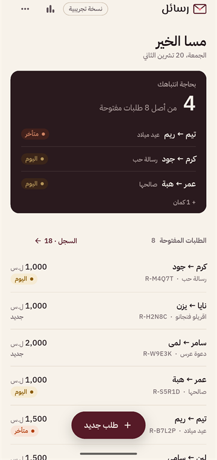
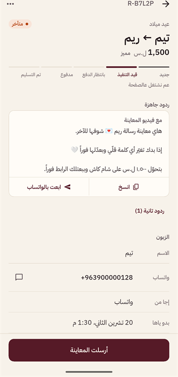
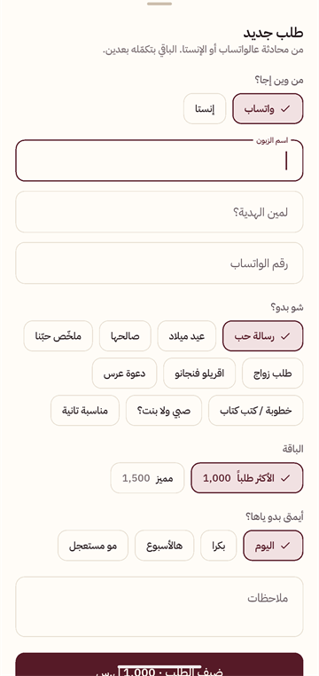
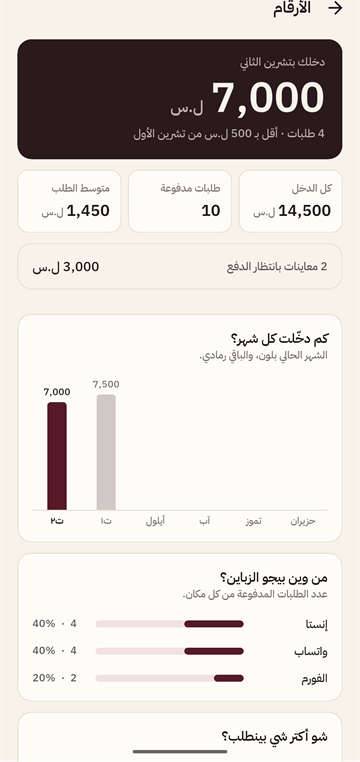
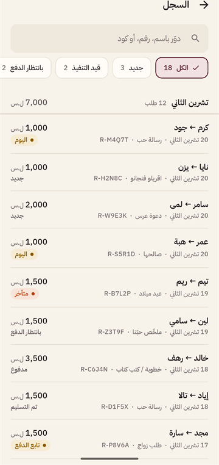
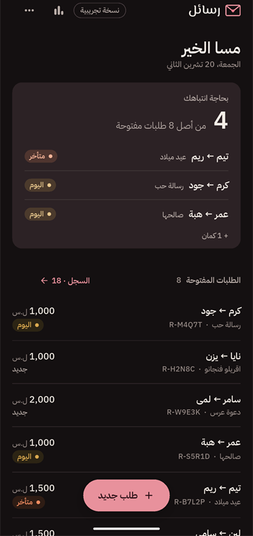
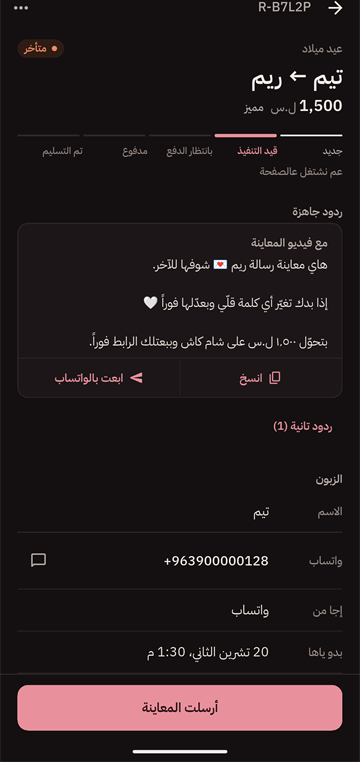
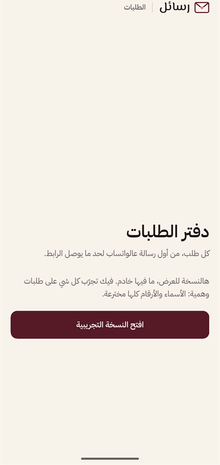

# Rasael Orders · دفتر الطلبات

The order book behind **Rasael** (رسائل), a small studio in Syria that sells
personalised Arabic gift pages: love letters, birthday pages, wedding
invitations. A customer messages from Instagram or WhatsApp, the page gets
built, a preview video goes out, the customer pays on Sham Cash, the link is
delivered. This app runs that loop, and it is in daily use for the real
business.

Flutter (Android + web), **Arabic-first and right-to-left**, on Supabase.

**[Try the demo →](https://samer-aljammal.github.io/rasael-orders/)**
The public build has no backend keys: it runs on invented orders only, so you
can add, move and search orders freely.

<p>
  
  
  
  
</p>
<p>
  
  
  
  
</p>

## What it does

- **Home answers "what needs doing now?"** One dark block lists only what
  needs attention: late orders, orders due today, previews unpaid for more
  than 48 hours. Everything on track stays quiet below it.
- **Quick add from a chat.** Most orders arrive as a DM from the Instagram
  bio page, so adding one asks only what that first message says: name,
  occasion, channel, package, when it's wanted. The app makes the `R-XXXXX`
  code in the same format as the studio's web order form.
- **A pipeline that matches the real process.** New → in progress → preview
  sent → paid → delivered. Customers pay after seeing the preview, so payment
  comes after it. Marking an order paid asks how (Sham Cash by default).
  Mistaken taps can be stepped back; cancellations are confirmed.
- **Ready replies, filled in.** Each stage offers the message that goes out at
  that point, with the customer's name, price (in Arabic-Indic digits, as the
  studio writes them) and link filled in. One tap opens WhatsApp with the text
  ready; a reply with a missing blank (no link yet) can't be sent.
- **History with Arabic-aware search.** Grouped by month with paid totals.
  Search folds hamza, taa marbuta and diacritics (`فاطمه` finds `فاطمة`) and
  matches phone numbers by their local digits (`0933 12` finds `96393312…`).
- **A dashboard that counts only real money.** This month against last, totals,
  money still awaiting payment, income per month, and which channel and
  occasion the paid orders came from.

## Design

Written down before the first screen: [`docs/DESIGN.md`](docs/DESIGN.md).

> **An order book, not a CRM.** Paper, ink, one wine-red seal.

- **Colour means attention.** Wine is the brand and the primary action; amber
  (due today / follow up) and vermilion (late) are the only status colours,
  and they always come with words. A delivered order is ink, not green.
- **Arabic first, not translated.** RTL is the layout. IBM Plex Sans Arabic for
  text and figures, El Messiri only for the wordmark, both bundled. No
  letter-spacing on Arabic (it breaks the joins); body line height 1.6 so
  diacritics are never clipped.
- **Bidi handled on purpose.** Order codes and phone numbers are wrapped in
  Unicode isolates so `R-K3F9A` never renders as `K3F9A-R`; prices are a
  figure and a quieter «ل.س» as separate widgets, so the RTL order can't flip.
- **Motion with restraint.** Spring press instead of ripples, entrances that
  play once, numbers that roll, charts that draw in, all off under the OS
  "reduce motion" setting. The motion system is shared with
  [Drivio](https://github.com/samer-aljammal/drivio).
- **Dark mode is designed, not inverted**: a wine-black ground, and the wine
  accent re-mixed to a dusty rose that holds contrast.

## Architecture

```
lib/
  core/          tokens (colour, type, space, motion), widgets, DI, routing
  features/
    auth/        AuthRepository (Supabase) and the demo session
    orders/      Order domain, search and input rules, Supabase | in-memory
                 repositories, home, history, order screen, quick add
    replies/     saved replies: templates, filling, per-stage suggestions
    dashboard/   BusinessStats (pure) and the dashboard screen
supabase/
  migrations/    schema, RLS, triggers, realtime
```

- **flutter_bloc** for state, **go_router** with an auth redirect and a shell
  route that shares one live subscription between screens, **get_it** for
  wiring. Only `core/di/injector.dart` knows Supabase exists.
- **Two backends behind one interface.** Supabase for the real account (live
  updates across phone and web), an in-memory repository for the demo. The
  demo applies stage changes with `Order.movedTo`, which mirrors the database
  trigger, and a test pins the two together.
- **The database does the bookkeeping.** Row-level security limits every row
  to its owner; a trigger stamps `preview_sent_at` / `paid_at` /
  `delivered_at` and writes the stage history, so two devices can never
  disagree about when an order was paid. Anonymous requests get nothing.
- **Pure domain logic, tested without Flutter**: attention rules, the pipeline,
  Arabic search folding, phone and handle normalisation, reply filling,
  monthly income.

## Running

Demo only, no backend:

```bash
flutter run
```

With your own Supabase project:

1. Run the files in `supabase/migrations/` in order in the SQL editor, then
   `supabase/check_connection.sql`; every row should say `ok`.
2. Add a user under Authentication → Users, and turn off public sign-ups.
3. Copy `env/example.json` to `env/dev.json` with your project URL and
   publishable key (`env/*.json` is git-ignored).
4. `flutter run --dart-define-from-file=env/dev.json`

## Tests

```bash
flutter test
```

38 tests: attention rules, the pipeline and trigger parity, the database row
mapping, code and phone normalisation, Arabic search, monthly grouping and
income, reply filling and stage matching, the demo repositories, and a full
widget run through demo → quick add → history search → order → paid.

## Licence

Code: MIT. Fonts: SIL Open Font License (see `assets/fonts`). The Rasael name
and logo belong to the studio.
